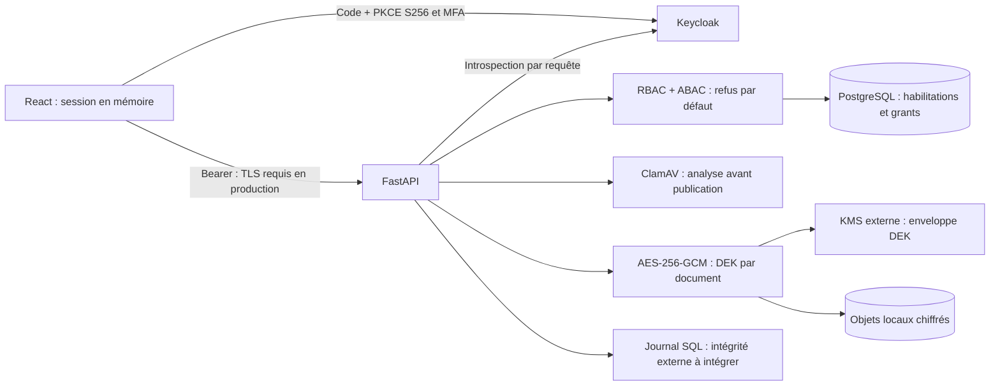
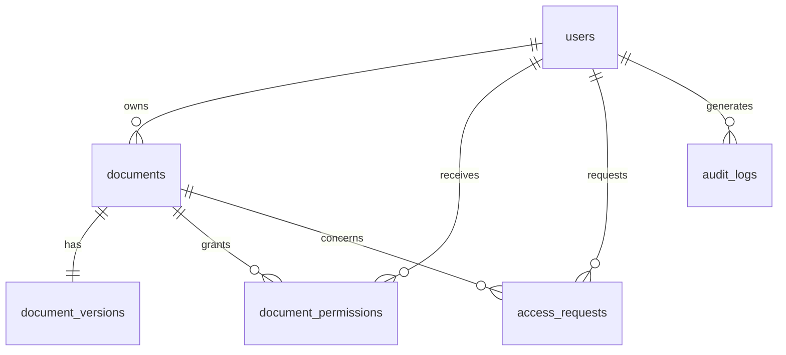

# Architecture
## Monorepo
- `apps/backend/app` : configuration, identité, politique, cryptographie, intégrations, modèles et API.
- `apps/backend/migrations` : schéma initial figé et environnement Alembic.
- `apps/backend/tests` : politiques, cryptographie, API et identité.
- `apps/frontend` : interface React, adaptateur OIDC, démonstration synthétique.
- `packages/policy-contracts` : niveaux et contrat de décision partagé.
- `infrastructure/keycloak` : realm de développement avec MFA obligatoire.
- `security/policies` : politique proposée.
- `.github/workflows` : compilation Pages et tests backend.

Les modules sont regroupés tant que leur volume ne justifie pas les nombreux fichiers vides de l’arborescence cible. Aucun module vide n’est présenté comme implémenté. Desktop Electron et mobile Flutter sont différés ; le client web est responsive.

## Flux

## Modèle livré

Les documents portent titre, propriétaire, département, niveau, compartiments, statut et expiration. Les versions portent seulement l’identifiant opaque de l’objet, son type, sa taille, le nonce, le DEK enveloppé et la référence de clé. Les clés maîtresses ne sont jamais en base. La première version est unique par document dans cette itération ; l’historique multiversion est différé.

Les rôles et compartiments sont pour l’instant des tableaux JSON administrés hors API. La normalisation complète des départements, rôles, permissions, classifications et historiques, ainsi que les autres entités du schéma cible, reste à livrer. Les métadonnées sont filtrées côté serveur, mais ne sont pas chiffrées au niveau applicatif ; PostgreSQL et ses sauvegardes doivent être protégés séparément.
